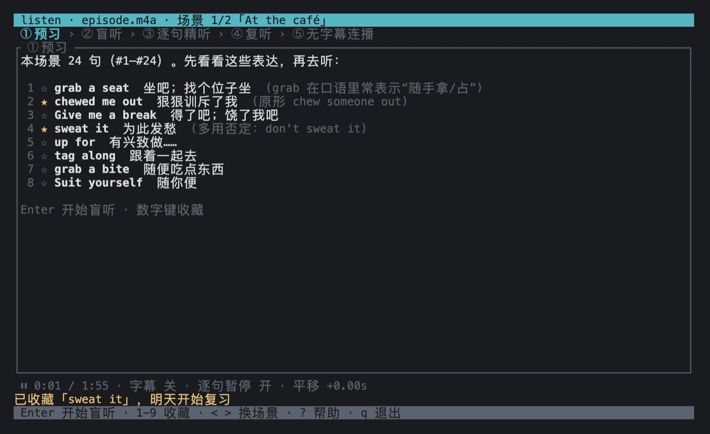
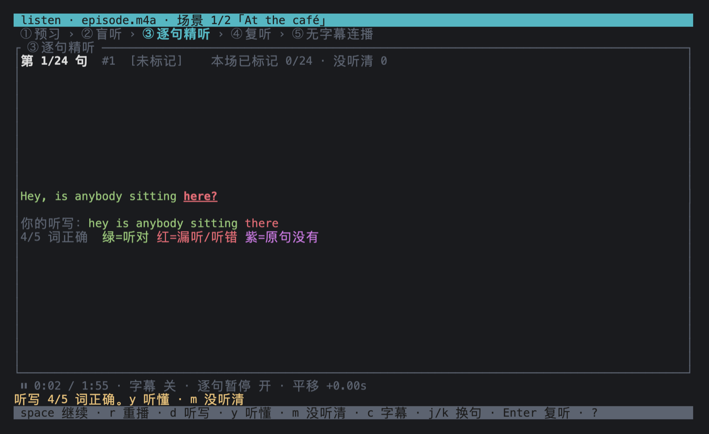
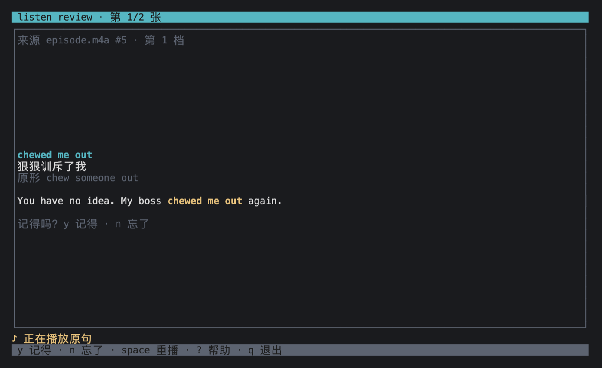

# language-learning

A lightweight terminal app for learning English by listening. Play an audio
episode with its subtitle file, study it scene by scene and sentence by
sentence, and review the expressions you saved with spaced repetition.


No audio or subtitle content ships with this repo; bring your own files.
Everything under `fixtures/` (and in the screenshots) is made-up dialogue
written for tests. The interface and the expression glosses are in Chinese,
since the app is aimed at Chinese-speaking learners.

## Install

### Homebrew (macOS, recommended)

```sh
brew tap wine-fall/language-learning https://github.com/wine-fall/language-learning
brew trust wine-fall/language-learning
brew install listen
```

Recent Homebrew versions refuse formulae from third-party taps until you trust
them, hence the `brew trust` step. Update with `brew upgrade listen`, remove
with `brew uninstall listen`.

If Homebrew stops with "Your Command Line Tools are too outdated", update them
from System Settings → General → Software Update first. The formula installs a
prebuilt binary, but Homebrew still checks the tools before installing any
formula without a bottle.

### Build from source

You need Rust (stable, 1.88 or newer). If you don't have it:

```sh
curl https://sh.rustup.rs -sSf | sh
```

#### macOS

```sh
cargo build --release
./target/release/listen --help
# optional: install into ~/.cargo/bin
cargo install --path .
```

macOS only needs the Xcode Command Line Tools (`xcode-select --install`, which
rustup needs anyway). Audio goes through CoreAudio, so no other libraries are
required.

#### Linux

Real audio playback needs the ALSA development package (`libasound2-dev` and
`pkg-config` on Debian/Ubuntu). Without a sound card, or if you'd rather not
install it, build the silent version. Everything else works the same, and
playback position just follows the clock:

```sh
cargo build --release --no-default-features
```

## Preparing files

Put files with the same base name in one directory:

```
episode.m4a           audio (m4a/AAC)
episode.srt           English subtitles (required)
episode.words.json    key expressions (optional, see below)
```

You can write `words.json` by hand or generate it with Claude Code:

```sh
LISTEN=./target/release/listen scripts/annotate.sh path/to/episode.srt
```

The script numbers the sentences with `listen cues`, hands the numbered
subtitles and the prompt in `scripts/annotate-prompt.md` to `claude -p`,
validates the result with `listen check`, and writes `episode.words.json`. It
picks at most 3 expressions per sentence, favouring spoken phrases and words
outside the 3,000 most common. Existing output is never overwritten unless you
set `FORCE=1`. To use another model, set `CLAUDE_ARGS="--model sonnet"`.

## Usage

```sh
listen play path/to/episode.m4a     # study an episode
listen play --whole path/to/episode.m4a   # the whole episode as one scene
listen review                       # review cards due today
listen review --all                 # review every card, due or not
listen cues path/to/episode.srt     # print sentence numbers (used by words.json "cue")
listen check path/to/episode.srt path/to/episode.words.json   # validate words.json
```

Opening the same episode again resumes at the scene where you left off.

## Study flow

Each episode is studied scene by scene, and every scene goes through five
stages (①–⑤ at the top of the screen):

1. **① Preview**: the scene's 5–8 key expressions with Chinese glosses, from
   `words.json`.
2. **② Blind listen**: the whole scene plays without subtitles.
3. **③ Sentence by sentence**: playback pauses after each sentence. Press `d`
   to type what you heard; on Enter the English line appears with a
   word-by-word comparison. Words you missed are red in the original line.
   In your dictation, misheard words are red and crossed out, and words that
   aren't in the sentence are purple, crossed out and listed on their own.
   Case and punctuation are ignored, and contractions such as `it's` / `it is`
   or `don't` / `do not` count as the same. Then press `y` (understood) or `m`
   (unclear) to move on. Once the English line is on screen, the sentence's
   key expressions are listed under it with pronunciation and Chinese gloss.
4. **④ Relisten**: replays only the sentences marked unclear.
5. **⑤ Final run**: the whole scene once more, without subtitles.

To go through an episode in one go instead, run `listen play --whole`. The
whole episode becomes a single scene, so the blind listen and the final run
play it from start to finish.

During continuous playback, a stretch of 20 seconds or more without subtitles
(usually the theme song) is skipped.

| Preview | Dictation | Review |
| --- | --- | --- |
|  |  |  |

**Review** is a separate mode, `listen review`. Each card first plays the
original sentence from the episode; recall the expression, press Enter to see
it with its gloss and the sentence, then grade yourself with `y` / `n`.

Subtitles have two settings only: off, or full English. Chinese glosses appear
for individual expressions only, and only after you have heard the sentence:
on the preview page, under a revealed sentence, and on review cards. Whole-line
translations are never shown.

This flow follows a few findings from second-language listening research:
same-language (English) captions help more than native-language subtitles,
pre-teaching key vocabulary before viewing improves retention, dictation-style
decoding practice improves listening, and spaced retrieval beats massed review.

### Scene splitting

- If `words.json` has `scenes`, those are used.
- Otherwise the subtitles are split at gaps: a silence of 4 seconds or more
  between two lines starts a new scene, with each scene kept between 20 and 50
  lines. Gaps that come too early are ignored; if there's no long gap within 50
  lines, the split goes at the largest gap in the allowed range. An episode with
  fewer than 20 lines is one scene.

## Keys

Study mode (`listen play`):

| Key | Action |
| --- | --- |
| `Enter` | Next stage: preview → blind listen → sentence by sentence → relisten → final run → next scene |
| `space` | Pause / resume; in stage ③, play the next sentence after a pause |
| `j` / `k` | Next / previous sentence (arrow keys work too) |
| `r` | Replay the current sentence (restart the scene in blind listen and the final run) |
| `p` | Toggle auto-pause after each sentence |
| `c` | Subtitles off / full English (always hidden in blind listen and the final run) |
| `d` | Dictate the current sentence: Enter submits, Tab replays, Esc cancels |
| `y` / `m` | Mark understood / unclear and move to the next sentence |
| `1`–`9` | Save the Nth key expression of the current sentence (on the preview page, the Nth in the list); press again to unsave |
| `[` / `]` | Shift the subtitle timing by −0.25 / +0.25 s, saved per file |
| `<` / `>` | Previous / next scene |
| `?` | Help |
| `q` | Save and quit |

Review mode (`listen review`):

| Key | Action |
| --- | --- |
| `space` | Play / replay the original sentence |
| `Enter` | Flip the card |
| `y` / `n` | Remembered / forgot |
| `?` | Help |
| `q` | Quit |

Review uses a simple Leitner system: 5 boxes with intervals of 1 / 2 / 4 / 7 /
15 days. Remembering moves a card up one box; forgetting sends it back to box
1. Newly saved cards start in box 1 and are due the next day.

## words.json

```json
{
  "items": [
    { "cue": 2, "text": "grab a seat", "ipa": "ˈɡræb ə ˈsit", "meaning": "坐吧；找个位子坐", "note": "口语" },
    { "cue": 5, "text": "chewed me out", "meaning": "狠狠训斥了我", "note": "原形 chew someone out" }
  ],
  "scenes": [
    { "start": 1, "title": "At the café" },
    { "start": 25 }
  ]
}
```

`items` (required, may be empty), each with:

| Field | Type | Meaning |
| --- | --- | --- |
| `cue` | integer | Sentence number, starting at 1, as printed by `listen cues` |
| `text` | string | The expression as written in the sentence (so it can be highlighted there) |
| `meaning` | string | Chinese gloss |
| `ipa` | string, optional | American IPA without slashes, shown as `/…/` on the preview page and review cards |
| `note` | string, optional | Extra note, such as the base form or tone |

Several expressions in the same sentence map to number keys 1–9 in file order.
The preview page shows at most 8 per scene, preferring multi-word phrases, then
sentence order.

`scenes` (optional), each with:

| Field | Type | Meaning |
| --- | --- | --- |
| `start` | integer | Number of the scene's first sentence; the scene runs until the next one starts |
| `title` | string, optional | Scene title, shown in the title bar |

Sentence numbers are positions in the subtitle file, skipping blocks without
timing or text. In a well-formed SRT they match the SRT's own numbering. See
`fixtures/sample.words.json` for a full example.

## Data

Study state is saved as `language-learning/state.json` in the data directory:

- macOS: `~/Library/Application Support/language-learning/state.json`
- Linux: `~/.local/share/language-learning/state.json`
- With `LL_HOME` set: `$LL_HOME/language-learning/state.json`

It records each episode's playback position, subtitle shift and per-sentence
understood/unclear marks, plus saved cards (with the source audio path and
sentence number, so review can replay the original line) and their review
schedule. If the file is corrupt, the app exits with an error instead of
overwriting it.

"Today" for review is the date in your local time zone (falling back to UTC if
the local offset can't be determined). Dates are stored in `state.json` as days
since 1970-01-01.

## Development

```sh
cargo build --no-default-features
cargo test --no-default-features
cargo clippy --no-default-features --all-targets -- -D warnings
cargo fmt --check
```

Audio sits behind the `audio` cargo feature, which is on by default.
`src/player.rs` defines the `Player` trait (play range / pause / resume / seek /
current position). With `--no-default-features` the app uses `NullPlayer`,
which only follows the clock and makes no sound; the tests use it too. The
rodio implementation is in `src/audio.rs`.

To publish a release, bump `version` in `Cargo.toml`, commit, and push a tag
such as `v0.2.0`. The release workflow builds the macOS binaries, publishes a
GitHub Release, and updates `Formula/listen.rb`.

## License

MIT
